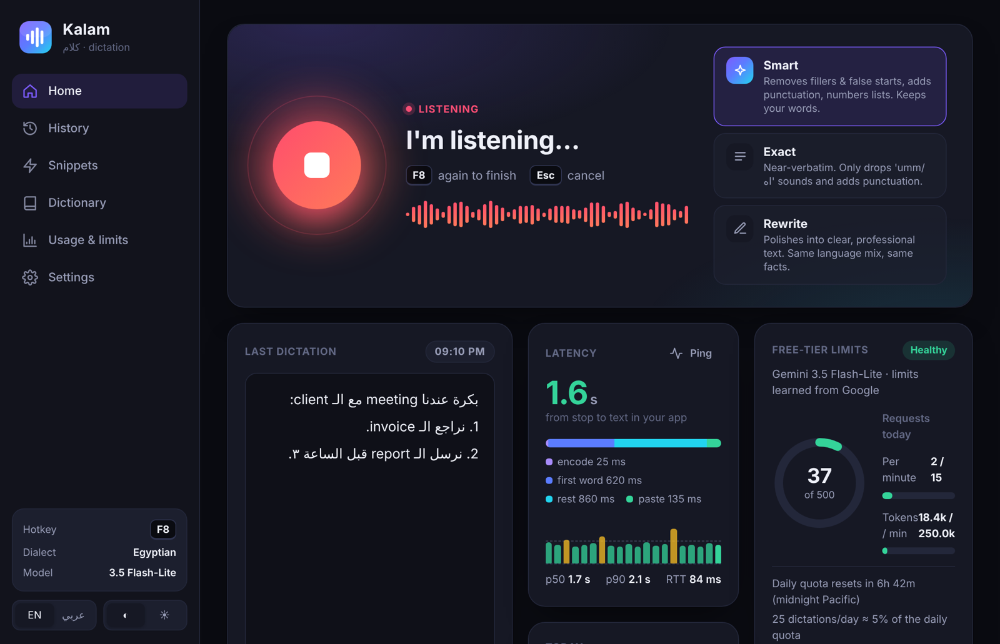
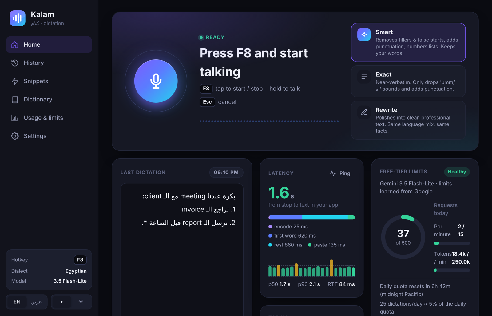
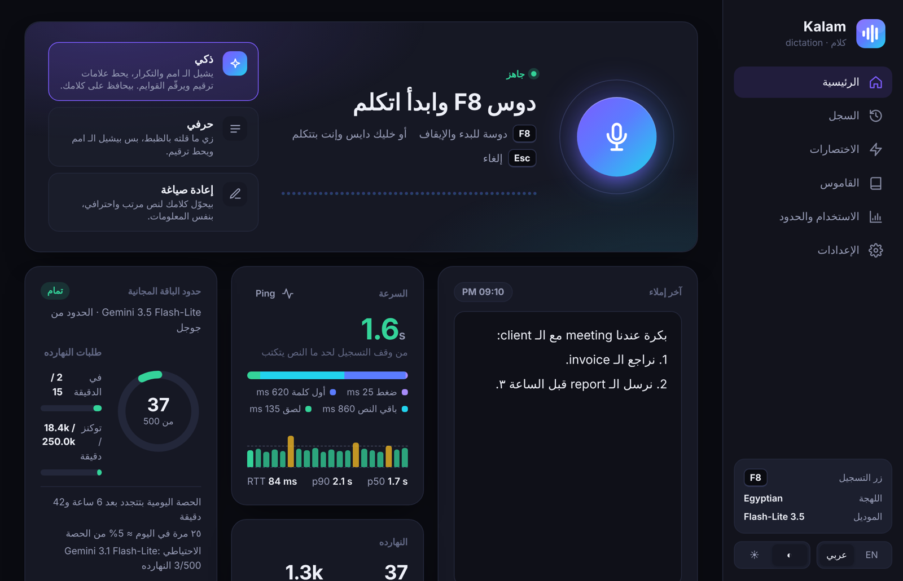
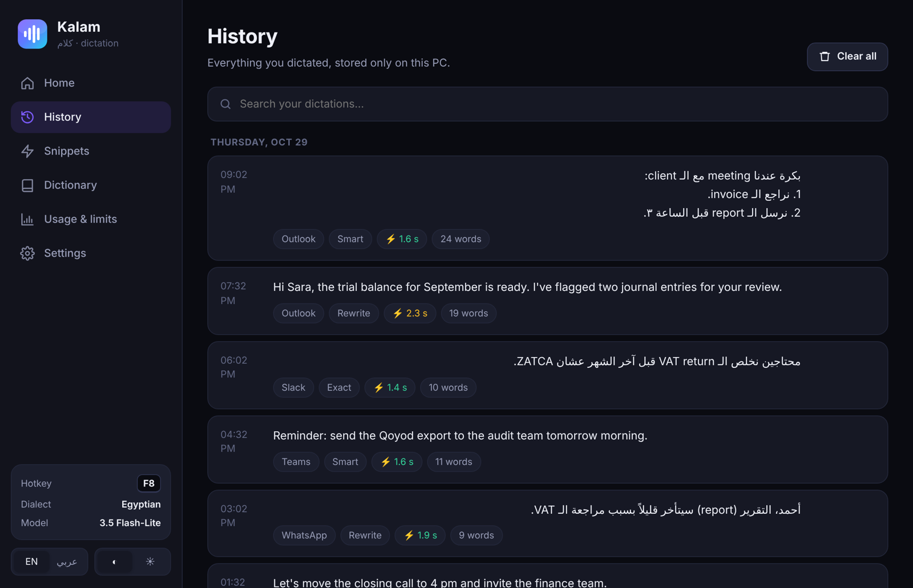
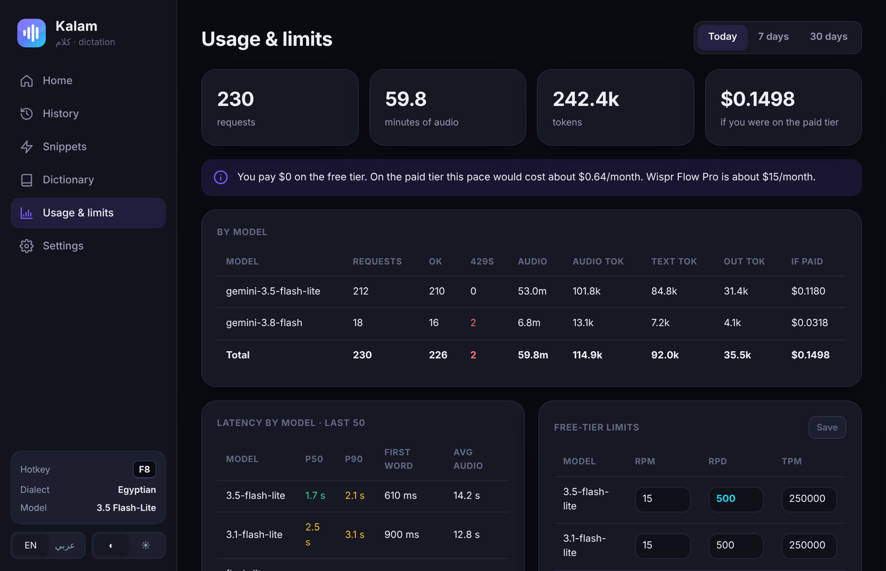
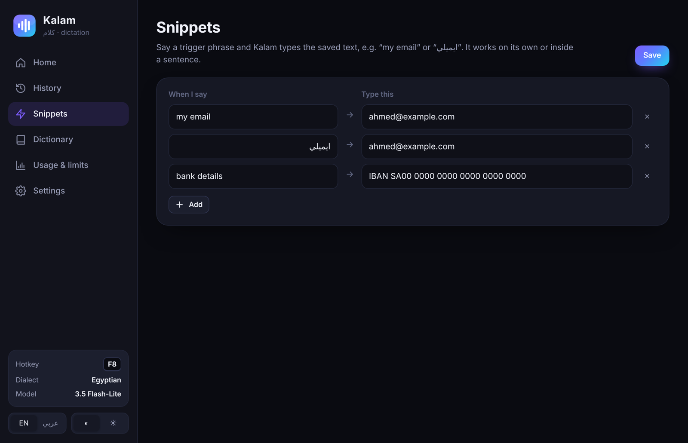
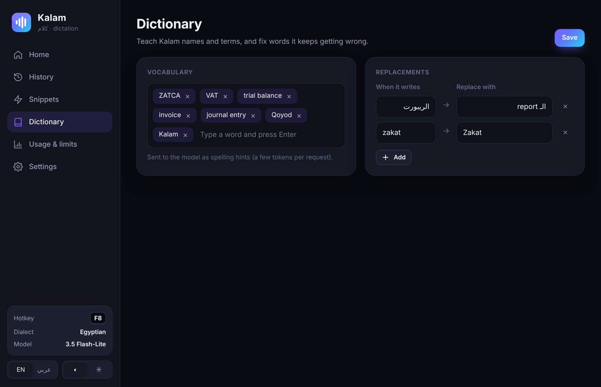
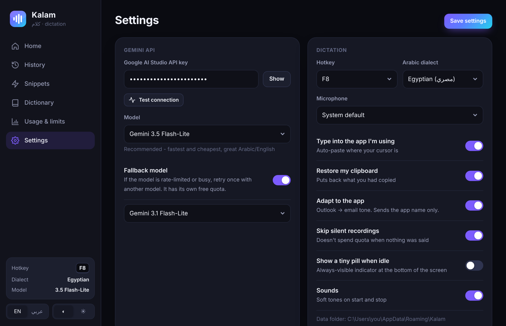
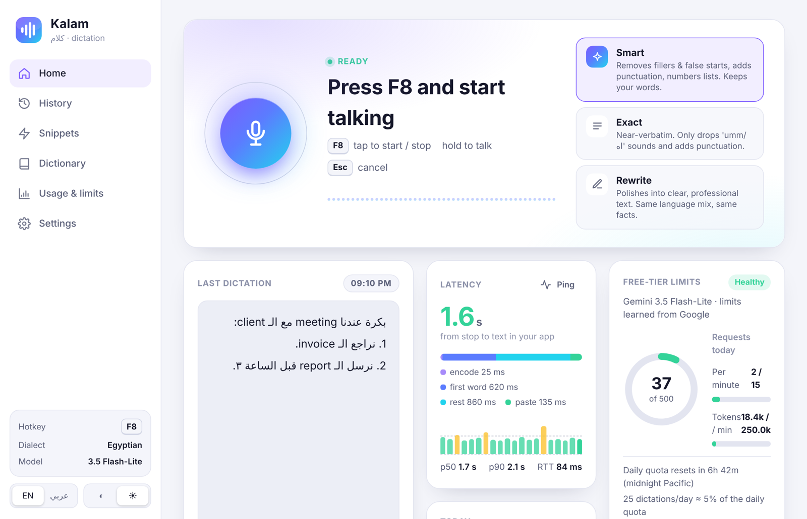

<div align="center">



# Kalam · كلام

**Talk instead of type, in Arabic, English, or both in one sentence.**

Press a hotkey in any Windows app, speak, and clean text shows up where your cursor is. It runs on the Gemini API free tier.


[Run](#run) · [Use](#use) · [Screenshots](#-a-look-inside) · [Models](#model-choice-benchmarked-2026-09-26-on-a-23s-mixed-arabicenglish-clip)

</div>

---

## 🎙️ A look inside

<table>
<tr>
<td align="center" width="50%"><br><sub><b>Home</b> · pick a mode, see your last dictation, latency and free-tier quota at a glance</sub></td>
<td align="center" width="50%"><br><sub><b>واجهة عربي كاملة</b> · full right-to-left Arabic interface</sub></td>
</tr>
<tr>
<td align="center"><br><sub><b>History</b> · every dictation, searchable, stored only on your PC</sub></td>
<td align="center"><br><sub><b>Usage & limits</b> · requests, tokens and what it would cost on the paid tier</sub></td>
</tr>
<tr>
<td align="center"><br><sub><b>Snippets</b> · say “my email” and get the full text</sub></td>
<td align="center"><br><sub><b>Dictionary</b> · teach it names and terms like ZATCA</sub></td>
</tr>
<tr>
<td align="center"><br><sub><b>Settings</b> · hotkey, dialect, mic, model and fallback</sub></td>
<td align="center"><br><sub><b>Light theme</b> · one click in the sidebar</sub></td>
</tr>
</table>

| | Why people like it |
|:-:|---|
| ⚡ | **Fast**: about 1.7 s from releasing the key to text in your app |
| 🌍 | **Mixed language**: «بكرة عندنا meeting مع الـ client» comes out exactly as you said it |
| 🧠 | **Three modes**: Smart, Exact, Rewrite (email tone in Outlook) |
| 🗣️ | **Dialects**: Egyptian, Gulf, Levantine, Formal Arabic |
| 💸 | **Free**: runs on the Gemini free tier, with live quota gauges |
| 🔒 | **Private**: settings and history stay in `%APPDATA%\Kalam` |

## Run

```
pip install -r requirements.txt
pythonw app.py            # or double-click Kalam.vbs
powershell -ExecutionPolicy Bypass -File install_shortcut.ps1          # Desktop + Start Menu shortcut
powershell -ExecutionPolicy Bypass -File install_shortcut.ps1 -Startup # ...and launch at sign-in
```

## Use

| Action | Key |
|---|---|
| Start/stop (tap) | **F8** |
| Push-to-talk | hold **F8** and release when you finish |
| Cancel | **Esc** |

You can change the hotkey in Settings.

- **Smart**: removes fillers (امم، um) and false starts, adds punctuation, and turns spoken lists (واحد، اتنين) into numbered lists.
- **Exact**: near-verbatim, with punctuation added.
- **Rewrite**: turns what you said into polished text. It adapts to the app you're in, for example an email tone in Outlook.
- **Snippets**: define a trigger phrase for text you use often.
- **Dictionary**: spelling hints (ZATCA, names) plus replacements that run after transcription.

## Model choice (benchmarked 2026-09-26 on a 23s mixed Arabic/English clip)

| Model | API latency | Notes |
|---|---|---|
| **gemini-3.5-flash-lite** (default) | ~1.8s | Cheapest and fastest. Mixed script and lists are correct. |
| gemini-3.1-flash-lite (fallback) | ~2.5s | Has its own free quota. |
| gemini-3.8-flash | ~5s | Best quality, but a small free quota. Good for Rewrite. |
| gemini-2.5-flash / -lite | — | Retired for new users (404). |
| gemini-3.5-transcribe | — | Not available on the free tier here. |

Latency tricks:
- Audio is compressed with Opus (about 6× smaller than WAV).
- Audio is encoded while you talk, so stopping adds only ~25 ms. Silent recordings are skipped.
- The HTTPS connection is warmed while you talk and reused afterwards.
- Thinking is set to minimal and the response is streamed.

## Rate limits and latency in the UI

- **Home → Rate limits**: live RPM, RPD and TPM gauges for the active model, plus a countdown to the daily reset (midnight Pacific).
- The starting limits are estimates. When Google returns a 429, Kalam reads the real quota from the error and saves it.
- **Home → Latency**: the time from stop to pasted text, split into first word, full answer, encode and paste. Also shows a sparkline, p50/p90 and a free Ping for network RTT.
- **Usage & limits**: requests, tokens, what it would cost on the paid tier, per-model latency, and editable limits.

Data (settings, API key, history DB) lives in `%APPDATA%\Kalam`. Nothing leaves your PC except the audio sent to Gemini.
